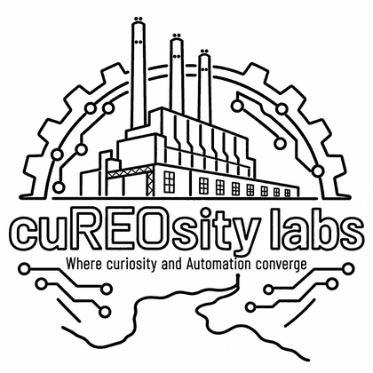

<p align="center">
  <a href="https://cureositylabs.com/"></a>
</p>

<h1 align="center">cuREOsity labs</h1>

<p align="center"><strong>Where curiosity and automation converge.</strong><br>
An independent technology workshop in REO Town, Lansing, Michigan.</p>

<p align="center"><a href="https://cureositylabs.com/"><strong>cureositylabs.com</strong></a> · <a href="mailto:hello@cureositylabs.com">hello@cureositylabs.com</a> · <a href="https://cureositylabs.com/#workbench">Start a project</a></p>

---

## What we do

Enterprise-grade software at a small-business price. Straight advice, custom software, connected systems, and private AI, built around the way your business already works.

| Service | Start here when… |
| --- | --- |
| **Consulting & strategy** | You're not sure what you need yet and want a straight answer before you spend a dollar. |
| **Custom software & databases** | A spreadsheet has outgrown itself. |
| **Integrations & middleware** | Your systems don't talk to each other, so someone types everything twice. |
| **QuickBase & ServiceNow** | You have a powerful platform and want software people actually enjoy using on top of it. |
| **Local & applied AI** | You want AI that runs on your own hardware and keeps your data in the building. |
| **Sensors & LoRa mesh** | You need custom IoT that works with or without the internet. |
| **Ledgers & Web3** | You need records nobody can quietly change. |

Every project starts small: a focused first version you can put your hands on, then growth only where it earns its keep. You talk to the person writing the code, and every system comes with plain-language notes on how it works.

## The website

`index.html` is the whole site. It's static, with no build step, and deploys straight from this repository with GitHub Pages at the custom domain in `CNAME`.

- **Hero:** a neon sign over a canvas river confluence (the Grand and the Red Cedar) that visitors can stir with the pointer. It pauses off-screen and shows a still frame for reduced-motion users.
- **What-if workbench:** visitors describe a problem and get a work order they can copy, download, or email.
  - **Send to the workshop** posts the work order to a Cloudflare Worker, which stores it for the lead inbox.
  - **Sharpen it with AI** sends the what-if description to the Worker's AI endpoint and shows the result, clearly labeled.
  - Endpoint URLs and `CONTACT_EMAIL` are set at the top of the main script.
- **`inbox.html`:** the private lead inbox. It's excluded from search (`noindex` and `robots.txt`).
- **Navigation:** the header links mark the section in view. On phones they become a scrollable row under the header.

| Path | What it is |
| --- | --- |
| `index.html` | The site: markup, styles, and scripts in one file |
| `inbox.html` | Private lead inbox |
| `assets/cureosity-neon.webp` | Neon artwork |
| `assets/og-card.png` | Link-preview card |
| `assets/logo-print.png` | One-color logo for print and this README |

### Run it locally

```sh
python -m http.server 8000
# open http://localhost:8000
```

## About

CuREOsity Labs LLC was founded October 13, 2026 by Thomas Charles Harwood in REO Town, the Lansing neighborhood built around Ransom E. Olds's REO Motor Car Company. No street address is published. The site makes no testimonial, client-logo, or outcome claims.

Founder: [thomas-harwood.com](https://thomas-harwood.com) · [github.com/ncypher](https://github.com/ncypher)
